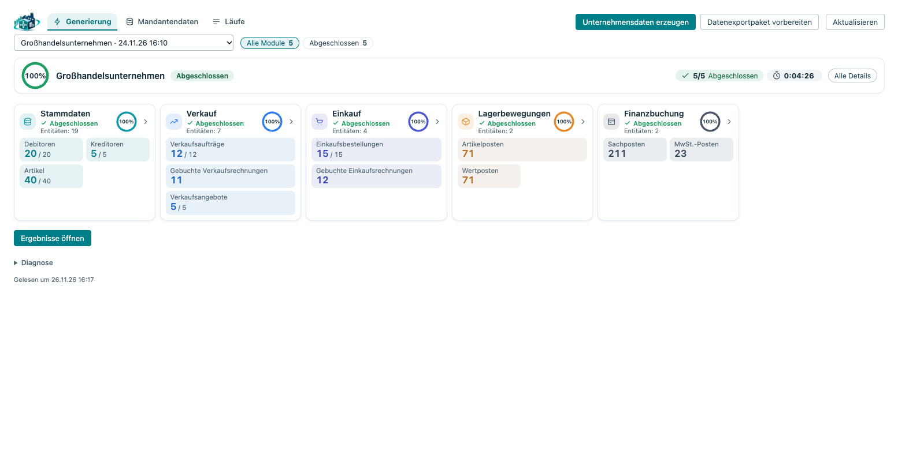
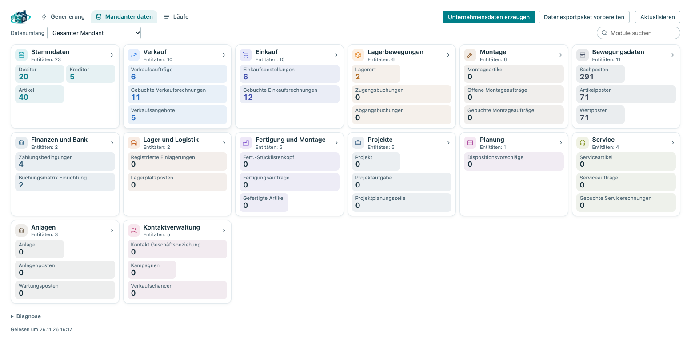
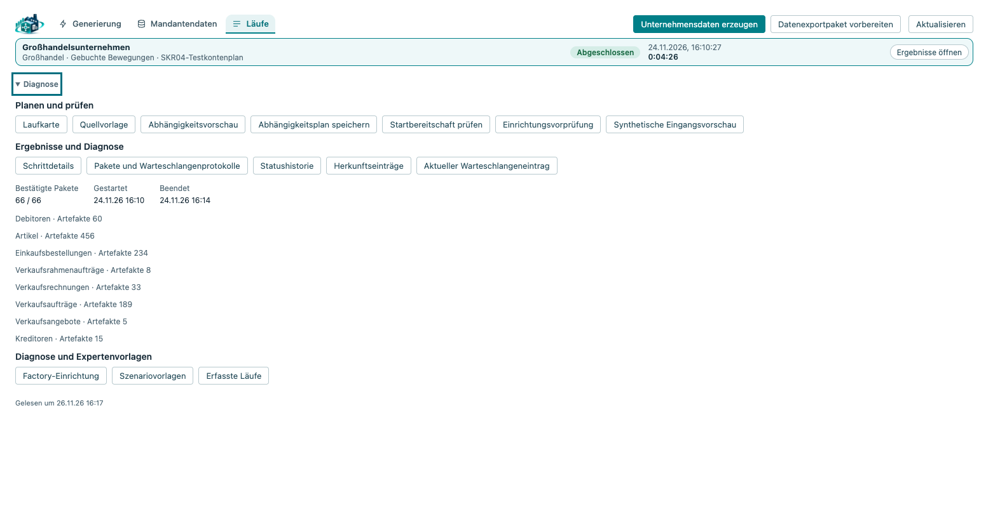
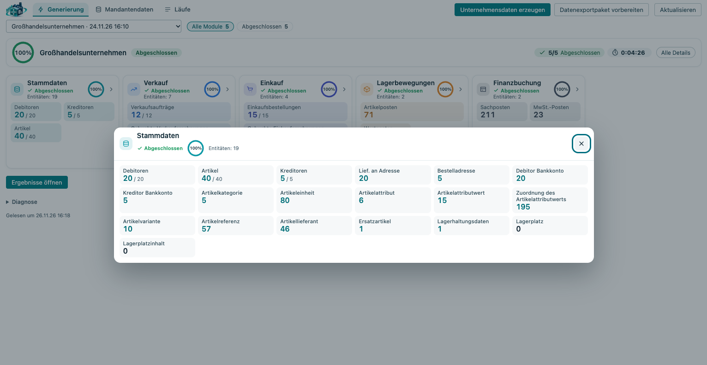
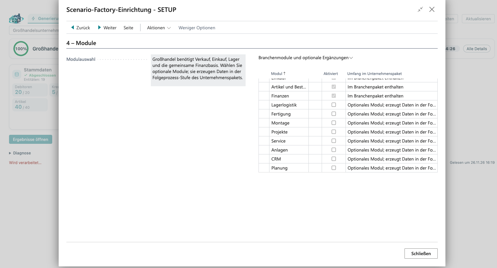

<p align="center">
  <picture>
    <!-- Hell/Dunkel: aktuell existiert nur ein Logo. Für einen Dunkelmodus eine zweite Datei anlegen und hier per <source media="(prefers-color-scheme: dark)" srcset="…"> einbinden. -->
    
  </picture>
</p>

<h1 align="center">BC Scenario Factory</h1>

<p align="center"><strong>Realistische synthetische Branchen- und Prozessdaten für Microsoft Dynamics 365 Business Central – per Standardbuchung, in der Sandbox.</strong></p>

<p align="center">
  
  
  
  
</p>

## Nutzen

Demo-, Schulungs-, Funktions- und Lasttestumgebungen brauchen zusammenhängende Daten, nicht nur viele gleichförmige Datensätze. BC Scenario Factory erzeugt in einer **Sandbox-Firma** Partner, Artikel, Einkaufs- und Verkaufsbelege sowie Folgeprozesse, die fachlich aufeinander aufbauen: Einkauf und Verkauf beziehen Partner und Artikel aus demselben Lauf, gebuchte Verkäufe stehen auf Wareneingängen. Gebucht wird ausschließlich über die **BC-Standardbuchung**; es gibt keine direkten Inserts in Standard-Postentabellen.

## Funktionen

- **Geführter Normalweg:** Kontenplan (SKR03/SKR04 oder vorhandene Einrichtung) → Branche → Größe (Klein/Mittel/Groß) → Prozessstufe → Zusammenfassung → ein Hintergrundstart. Derzeit ist nur das **Großhandelspaket** freigegeben; andere Branchen und nicht unterstützte Buchungsstufen bleiben gesperrt.
- **Vier Prozessstufen:** Stammdaten · ungebuchte Belege · gebuchte Belege · Zahlungen/Ausgleich.
- **Ausführbare Generatoren:** Debitoren, Kreditoren, Artikel, Einkaufsbestellungen und -rechnungen, Verkaufsangebote/-aufträge/-rechnungen sowie Zahlungen mit Teilzahlung, Raten und offenen Posten.
- **Optionale Folgeprozesse:** Gutschriften und Retouren, Lagerbewegungen ohne WMS, Lagereingang/Einlagerung, Fertigung, Montage, Projekte, Service, Anlagen, CRM und Planungsvorschläge.
- **Queue-Läufe:** Batches, Checkpoints, Wiederaufnahme, Pause/Abbruch an sicheren Grenzen und Schutz vor Doppelbuchung nach unsicherem Retry.
- **Dashboard (Control Add-in):** Läufe, Mandantendaten und Generierung in drei Ansichten mit Modulkarten, Aktivitätsfeed und Drilldowns auf BC-Listen.
- **Reproduzierbar:** Seed, konfigurierbare Zielmengen, Zeiträume und Quoten; Vorlagen, Startervorlagen sowie Import/Export von Vorlagen.
- **Konfigurationspaket:** Export der erzeugten Daten über ein RapidStart-Paket (Auswertung, kein Migrationspaket).
- **Sicherheit:** Umgebungs- und Mandantenprüfung auch im Hintergrundcode, ausdrückliche Freigabe der Generierung, Buchungsfreigabe getrennt.
- **Zweisprachig:** Deutsch und Englisch (XLIFF; Dashboard mit gebündelter Übersetzung).

## Screenshots

Aufnahmen aus einer Sandbox-Firma mit dem Großhandelspaket (gebuchte Belege ohne Zahlungen).

**Generierung:** Gesamtfortschritt in einer Zeile und kompakte Modulkarten mit Soll/Ist-Mengen.



**Mandantendaten:** Datenbestand der gesamten Firma, Kennzahlen öffnen die Standardlisten.



**Läufe:** Laufhistorie mit direkter Ergebnisaktion, darunter Diagnose und Expertenvorlagen.



**Detailansicht eines Moduls:** alle erzeugten Entitäten mit Erzeugt/Ziel.



**Einrichtung – Modulauswahl:** Branchenmodule sind gesetzt, optionale Module wählbar.



## Ablauf in Kürze

```
Einrichtung (einmalig) → Vorlage / Assistent → Snapshot + Plan → Job Queue
   → Batches mit Checkpoints → BC-Standardbuchung → Qualitätsabschluss → Dashboard / Laufmonitor
```

Module liegen unter `src/<Modul>/<Objekttyp>/` (24 Module, 157 AL-Dateien). Details: [Architektur](docs/ARCHITECTURE.md), [Modulindex](docs/modules/INDEX.md).

## Schnellstart

**Voraussetzungen** (aus `app.json`): Business Central **Application 28.0.0.0**, AL-Runtime **17.0**, ID-Bereich 90100–90999, keine App-Abhängigkeiten. Eine **SaaS-Sandbox-Firma** ohne produktive Daten; die App legt keine Firma an.

1. Projekt in VS Code mit der AL Language Extension öffnen, Symbole der Ziel-Sandbox laden (`.alpackages/` ist nicht versioniert) und bauen. Es liegt kein fertiges Paket im Repository.
2. App in der Sandbox veröffentlichen. Installation und Upgrade legen keine Vorlagen oder Standarddaten an.
3. Berechtigungssatz **BCSF ADMIN** („Scenario Factory Setup Admin“, ID 90105) zuweisen; für Einrichtung und Buchung zusätzlich passende Standardrechte (BCSF ADMIN allein vergibt keine Standardtabellenrechte).
4. **Scenario-Factory-Einrichtung** öffnen → **Mandant initialisieren** → Kontenplan wählen.
5. Assistenten bzw. eine Startvorlage ausführen und im **Laufmonitor** bzw. Dashboard verfolgen. Ausführlich: [Mandanteneinrichtung](docs/COMPANY_INITIALIZATION.md), [Branchenpaket](docs/INDUSTRY_INITIALIZATION.md).

> **Nur Sandbox/Testbetrieb.** Nicht in Produktionsmandanten verwenden.

## Dokumentation

| Thema | Dokument |
| --- | --- |
| Projektstand, Manifest | [PROJECT](docs/PROJECT.md) |
| Architektur, Datenfluss | [ARCHITECTURE](docs/ARCHITECTURE.md) · [DATA_MODEL](docs/DATA_MODEL.md) |
| Modulverzeichnis | [modules/INDEX](docs/modules/INDEX.md) |
| Einrichtung und Branchenpaket | [COMPANY_INITIALIZATION](docs/COMPANY_INITIALIZATION.md) · [INDUSTRY_INITIALIZATION](docs/INDUSTRY_INITIALIZATION.md) |
| Vorlagen, Import/Export | [STARTER_TEMPLATES](docs/STARTER_TEMPLATES.md) · [CONFIG_EXPORT](docs/CONFIG_EXPORT.md) |
| Dashboard | [DASHBOARD_EMBEDDING](docs/DASHBOARD_EMBEDDING.md) · [DASHBOARD_DATA_STOCK](docs/DASHBOARD_DATA_STOCK.md) |
| Hintergrundverarbeitung, Recovery | [BACKGROUND_PROCESSING](docs/BACKGROUND_PROCESSING.md) · [RECOVERY](docs/RECOVERY.md) |
| Sicherheit | [SECURITY](docs/SECURITY.md) |
| Konventionen | [CONVENTIONS](docs/CONVENTIONS.md) |
| Tests und Nachweise | [TESTS](docs/TESTS.md) · [Manueller Testkatalog](docs/MANUELLE_TESTS.md) |
| Aufgaben und Tickets | [TODO](TODO.md) · [AGENTS](AGENTS.md) |

## Tests

- Separate Test-App `tests/SF019/` mit **79 Testmethoden** (im Code gezählt; in der Aufräumung vom 26.11.2026 nicht ausgeführt).
- Statische Prüfskripte in `scripts/`; Stand und Abweichungen in [TESTS](docs/TESTS.md#verifizierter-teststand-26112026-und-manueller-katalog).
- Native Sandbox-Abnahmen je Ticket stehen in `TODO.md` und `docs/review/`. Manuelle Fälle: [MANUELLE_TESTS](docs/MANUELLE_TESTS.md).

## Lizenz

[MIT](LICENSE) © 2026 Samer Dadah.
