# Zielarchitektur und implementierte Grundlagen

**SF-022 / Datumszeitraum 1.0.7.3:** Initialisierung friert Start/Ende (gestern) im bestehenden Request ein. Snapshot datePolicyVersion 1 steuert neue artikelbezogene Einkaufsdaten und Zahlungen nach Rechnung; fehlender Marker bewahrt Legacy-Daten. Einzelverkauf prüft weiterhin Bestand zum konkreten Datum. [Vertrag und native Prüfgrenzen](INDUSTRY_INITIALIZATION.md#sf-022--datumszeitraum-1073). **Zur Prüfung**.

**SF-022 / 1.0.7.2, aktueller Nachauftrag:** Unternehmensassistent: Kontenplan → Branche → Module → Größe → Prozessstufe → Zusammenfassung/Start. Wholesale Profile bestimmt Pflichtmodule und kanonische Planungszusätze. Factory Setup hält einen unveränderlichen Request, vorhandene Scenario-Module/Snapshotzeilen übernehmen die Auswahl. Nur tatsächliche Entitätsziele erzeugen Queuearbeit; Planungszusätze erzeugen weder Ziele noch Ergebnisse. [Umsetzung und Prüfgrenzen](INDUSTRY_INITIALIZATION.md#sf-022--modulauswahl-1072). **Zur Prüfung**.

## SF-045 – aktueller verbindlicher Ablauf

Kontenplan einmalig → tatsächlich unterstützte Branche → drei Größen mit versionierten Mengenverhältnissen → unterstützte Prozessstufe → ein Hintergrundstart. Gemeinsame Einrichtung und Branchenvoraussetzungen kommen vor Stammdaten, diese vor Belegen/Buchungen. Neue Generatoren nutzen vorhandene Registry, Snapshots, Queue, Checkpoints, Qualitätsabschluss und Dashboard; keine zusätzlichen Assistenten oder parallele Vorlagen-/Finanzeinrichtung. Technische Konfiguration bleibt optionaler Expertenzugang. Aktuell Großhandel mit vier Prozessstufen einschließlich Standardbeschaffung und Zahlungen/Ausgleich implementiert (1.0.7.0); native Buchungs-/Rechteabnahme offen. Dashboard liest alle zwei Sekunden ohne vollständigen DOM-Neuaufbau. [Konkreter Vertrag](INDUSTRY_INITIALIZATION.md). Frühere Normalabläufe dieses Dokuments sind historische Zwischenstände.

**Aktueller Stand ab 1.0.2.0:** Der reale Bedienweg ist in [Mandanteneinrichtung und Vorlagenstart](COMPANY_INITIALIZATION.md) beschrieben. Ältere Angaben zu Finanzauswahl je Vorlage, Vorschaufenster, Wizard, parallelen Lauflisten und Dashboard-Host sind historische Nachweise. Entfernte Objekt-IDs bleiben unbenutzt.

**Status:** Das End-to-End-Bild bleibt Zielarchitektur. Core, Lifecycle-Sicherheit und Szenariokonfiguration sind seit SF-003–SF-006 in 32 AL-Objekten implementiert; die übrigen 21 Module enthalten noch keinen AL-Code. Build-/Laufzeitgrenzen siehe [FOUNDATION.md](FOUNDATION.md) und [TESTS.md](TESTS.md).

## End-to-End

```text
Wizard / Scenario Card / Dashboard
         |
Scenario Configuration (Branche, Module, Mengen je Entität, Seed, Zeitraum, Umfang)
         |
Environment Guard + Preflight + Permission Checks
         |
Profile Resolver -> Module Registry -> Dependency Graph -> Setup Plan
         |
Generation Plan (Schritte, Reihenfolge, geschätzte Arbeitspakete)
         |
Job Queue Dispatcher / Worker / Batch Ledger / Checkpoints
         |
Data Generation Engine   -> Stammdaten und konsistente Beziehungen
Process Engine           -> Dokumente / optionale Standardbuchungen / Zahlungen
         |
Validation / Quality     -> Soll-Ist, Beziehungen, Ledger, Business Rules
         |
Run History / Monitoring / Exporte / Lifecycle & Safety
```

## Schichten

- **Fachkonfiguration:** Unveränderlicher Lauf-Snapshot; erkennbarer Szenario-Typ (Demo, Training, Functional, Performance), Branchenprofil mit Versionsstand, Mengen je Entität, Datenverteilung, Zeitfenster und Seed.
- **Planner:** Dependency Manager prüft gerichteten Abhängigkeitsgraph, erkennt Zyklen, unterscheidet zwingende Vorbedingungen, optionale Schritte und externe Abhängigkeiten. Setup Manager erzeugt einen **Preview-/Freigabeplan** für erforderliche Einrichtungen.
- **Engines:** Data Generation Engine erzeugt semantisch valide Stammdaten/Beziehungen. Process Engine erzeugt wahlweise ungebuchte Dokumente oder verwendet **Standard-BC-Posting-Codeunits** nach Prüfung der konkreten API/Version; keine Inserts direkt in Ledger Entries.
- **Execution:** Background Processing plant verarbeitbare, idempotent ausgelegte Batches. Dashboard liest persistente Statusdaten; keine Abhängigkeit von offener Browser-Sitzung.
- **Validation/Guard:** Vergleicht Ziele mit tatsächlich erzeugten Daten, prüft Posten/Konsistenz und verhindert produktive/destruktive Aktionen.

## Geplante zentrale Persistenz (logische Entitäten, keine festgelegten AL-Objektnamen)

| Entität | Inhalt / Primärbeziehung |
| --- | --- |
| Factory Setup | Globale Defaults, zulässige Sandbox-/Mandantenstrategie, Limits |
| Scenario Definition | Wiederverwendbare Vorlage, Branche, Seed, Datumsspanne |
| Scenario Module Selection | Welche Generatoren und Modi pro Szenario |
| Scenario Data Target | Gewünschte Menge **je Entität** statt globaler unklarer Zahl |
| Scenario Profile Rule | Parameter, Datenverteilungen, realistische Geschäftswahrscheinlichkeiten |
| Run Header | Snapshotted Konfiguration, Owner, Zustand, Start/Ende |
| Run Step | Modul/Generator, Abhängigkeit, Soll/Ist, Zustand |
| Batch | Eindeutige Batch-ID, Zustandsmaschine, Versuche, Checkpoint, Fehler |
| Generated Record Registry | Zuordnung `Run/Step/Entity/LogicalKey` zu erzeugten Records und Herkunft |
| Validation Result | Prüfregel, Objekt-/Datensatzbezug, Schweregrad, Ergebnis |
| Run Event / Metrics | Zeit, Mengen, Fortschritt, knappe Fehlertypen |

**Entwurfsregel:** Für Referenzen auf standardmäßige Posting-Ergebnisse einen geeigneten stabilen Schlüssel/Verknüpfungsweg ermitteln; RecordId allein ist keine über alle Folgeprozesse passende universelle Kennung. Datenmodell und Aufbewahrung müssen vor dem Coding konkretisiert werden.

## Generatorschnittstelle (Konzept, keine festgelegte AL-Signatur)

- `DescribeCapabilities`: unterstützte Entitäten, Modi, benötigte Module/Versionen.
- `CheckPrerequisites`: liest Setup/Abhängigkeiten, meldet Blocker.
- `PlanBatches`: zerlegt Ziel in deterministische, nicht überlappende Arbeitsbereiche.
- `ExecuteBatch`: erstellt Daten nach den Constraints, protokolliert Erfolg/Fehler.
- `ValidateOutput`: prüft erwartete fachliche Beziehungen und Mengen.
- `Resume`: verarbeitet nur nachweislich fehlende/incomplete Einheiten.

AL-Interfaces, Enums/Registrierungsstrategie, Übergabeparameter und Datenbanktransaktionsgrenzen müssen **vor Implementierung** im Ticket freigegeben und anhand der BC-Version überprüft werden. Keine generischen dynamischen Inserts, die Validierung und Business-Logik umgehen.

## Transaktions- und Wiederaufnahmestrategie

**Laufzustände:** Draft → Preflight → Ready → Queued → Running → Completed / CompletedWithWarnings / Failed / Cancelled. Unterbrochene Läufe können Paused / ResumePending werden (konkrete AL-Zustände noch zu definieren).

**Batchzustände:** Pending → Claimed/Running → Completed bzw. Failed/RetryPending. Checkpoints nur nach tatsächlich persistierten fachlichen Ergebnissen. Sperren/Leases und konkurrierende Queue-Sessions prüfen. Bei unklaren Commit-Ausgängen zuerst erzeugte Datensätze recherchieren, **nicht blind erneut buchen**. Wiederholung ist je Generator nachzuweisen, nicht pauschal vorauszusetzen. Kontrollierte Fehlerisolation (nicht jeder Fehler darf zum Abbruch des gesamten Laufs führen) und Dead-Letter-/manuelle Prüfung für dauerhafte Fehler.

Für unterschiedliche Arbeitsarten variable Batchgrößen (Stammdaten ≠ Buchungsprozesse), Laufzeitbudgets und Queue-Last. Gesamtlaufzeit nicht garantieren. Keine Annahme, dass parallele Jobs in einer BC-SaaS-Umgebung beliebig skalieren.

## Abhängigkeitsmuster (Handel)

Finanz-Grundsetup (Buchungsgruppen, Nummernserien, Steuer-/MWSt.-Kontext, Zahlungsbedingungen, Dimensionen, Bank/Lager-Setup) → Debitoren, Kreditoren, Artikel/Lagerorte → Einkauf/Wareneingang/Lagerbestand → Verkauf/Lieferung/Rechnung → optional Zahlung/Ausgleich. Je nach Beleg- und Bestandsmodus einzelne Vorbedingungen zusätzlich erforderlich.

## Erweiterbarkeit und Grenzen

Neue Industrieprofile konfigurieren die vorhandenen Fachgeneratoren. Weitere ISV-/Branchen-Generatoren können **erst nach festgelegtem Interfacevertrag** registriert werden. Nicht jedes Standard-BC-Modul ist in jeder Lizenz/Lokalisierung vorhanden; Features zur Laufzeit geprüft. XERJ/Codex sind Entwicklungswerkzeuge außerhalb von BC und **nicht Bestandteil** der Extension.

## Generator-Qualitätscheckliste (SF-042)

Diese Regeln konkretisieren den bestehenden Produktvertrag für jedes neue oder geänderte Generator-Ticket. Vor Umsetzung unterstützte Entitäten, Modi, Einrichtung und Grenzen im Ticket und zugehörigen Modul festhalten; nach Umsetzung die tatsächlichen Nachweise ergänzen.

1. **Datenrealismus:** Natürliche, vielfältige synthetische Fachwerte und plausible Beziehungen. Keine Test-/Demo-/Muster-Präfixe oder Zählersuffixe in Fachfeldern; Herkunft über die Registry. Keine echten Kommunikations- oder Zahlungsdaten.
2. **Voraussetzungen:** Gemeinsame Basis einmal über die Mandanteneinrichtung vorbereiten. Referenzierte Einrichtung und Vorgängerstämme vor der ersten abhängigen Anlage sowie im Hintergrund erneut prüfen. Passende vorhandene Einrichtung nutzen; keine Dummy-Konten oder stillen Überschreibungen. Maßgeblich ist die [Stammdatenmatrix](MASTER_DATA_READINESS.md#modul--und-entitätsmatrix).
3. **BC-Standard:** Feldvalidierungen und Standardanlage verwenden; Belege und Posten ausschließlich über die passenden Standardprozesse buchen. Fehlende Generator-, Rechte- oder Setupabdeckung blockiert den betreffenden Umfang.
4. **Herkunft und Wiederanlauf:** Lauf/Snapshot, logische Schlüssel, SystemIds und Elternbeziehungen nachvollziehbar halten. Fachliche Anlage, Herkunft und Paketabschluss teilen die vorgesehene Transaktion. Bestätigte Arbeit nicht wiederholen; unklare Arbeit bleibt ohne gesicherten Nachweis gesperrt. [Recovery-Vertrag](RECOVERY.md).
5. **Statistik und Datenzugriff:** Jede neue Entität mit verständlicher Bezeichnung, Zählquelle und passendem berechtigtem Standardlisten-Drilldown berücksichtigen. Ziel, bestätigte Arbeit und heute sichtbarer Datenbestand getrennt halten. Filtergrenzen und fehlende Listen offen benennen. [Dashboard-Vertrag](DASHBOARD_DATA_STOCK.md).
6. **Sprache:** Oberfläche folgt der BC-Sitzung; erzeugte Fachwerte folgen der eingefrorenen Datensprache und Regelversion. Vorhandene Daten werden bei Sprachwechsel nicht umgeschrieben.
7. **Nachweis:** Je Modul fachlicher Sandbox-Erfolgsfall, passender Negativ-/Wiederanlauffall und Dashboard-Drilldown. Umgebung, Eingaben, Soll/Ist und Grenzen gemäß [Testvertrag](TESTS.md#sf-042--prüfumfang-je-generator) dokumentieren. Lokale Tests ersetzen diese Abnahme nicht.

Stand der SF-042-Prüfung vom 19.11.2026: Customer und Vendor waren mit ihren Liefer-/Bestelladressen ausführbar. Artikel, Einkauf, Verkauf und Folgeprozesse blieben eigene Tickets unter dem damaligen P0-Freigabevertrag. Spätere ausdrücklich beauftragte Umsetzungen und ihre Grenzen stehen in den datierten SF-019-/SF-021-Abschnitten unten; sie ersetzen keine menschliche Abnahme von SF-042.

## Konkretisierung durch SF-002 (11.11.2026)

[OBJECT_PLAN.md](OBJECT_PLAN.md) definiert geplante Objektzuständigkeiten, Namen, IDs und erlaubte direkte Codeabhängigkeiten. Dieser Graph ersetzt die früheren allgemeinen Code-Abhängigkeitsannahmen in den Modulskeletten. Fachliche Reihenfolgen bleiben davon getrennte Laufplanregeln. Core ist unabhängig; Generatoren implementieren den Vertrag aus ModuleRegistry. Run Header/Run Step/Snapshot gehören ScenarioManagement, Batches BackgroundProcessing, Herkunft DataGeneration, Validierungsbefunde Validation. Monitoring liest Ausführungsstände, Ausführung referenziert Monitoring nicht. Tabellen und Pages sind weiterhin nicht implementiert; der Plan legt noch keine BC-APIs oder Commit-Garantien fest.

## Umsetzung SF-003/SF-004 (11.11.2026)

Setup-Card → Core Setup Management → firmenbezogene Setup-Tabelle; Lifecycle-Subscriber prüfen den tatsächlichen Sandbox-/Firmenkontext vor Insert/Modify. Delete/Rename sind gesperrt. Keine ausführbare Core-Rückreferenz auf Lifecycle; ausschließlich das deklarative Core-Permission-Set bündelt dessen Execute-Recht. Tabelle prüft vollständige Datensätze auch ohne Feld-Validate. Reines Öffnen/Lesen schreibt nicht, Initialisierung sperrt/prüft Existenz und schreibt ohne eigenen Commit. Der Guard bietet den wiederholt aufzurufenden Vertrag für spätere Worker; persistierte Laufzustände und fachliches Retry sind noch nicht vorhanden. Details und Run-Zustandsgraph: [FOUNDATION.md](FOUNDATION.md).


## Umsetzung SF-005/SF-006 und Sprache

Vorlagenliste/-karte → Scenario Manager/Policy → firmenbezogene Vorlage/Module/Ziele; Kindschreibwege sperren/erhöhen den Elternkopf. Lifecycle sichert die fünf neuen Tabellen per verpflichtendem Before-Event, ScenarioManagement prüft Inhalte und Unveränderlichkeit. Keine ausführbare Rückabhängigkeit zu Lifecycle.

Snapshot Writer sperrt Elternkopf und Setup, erstellt Draft-Laufkopf plus JSON-BLOB ohne Commit. Nur dieser feste Codepfad erhält indirektes Insert; Kopf/Payload bleiben nach Insert unveränderlich. Lauf-Unterseiten laden temporäre Anzeigekopien aus dem Payload; kein Lesen aktueller Vorlagen für die Rekonstruktion. Keine persistente Statusverarbeitung oder Queue vorweggenommen.

Core löst Automatisch zu Deutsch/Englisch auf; der Snapshot hält Auflösung und Katalogversion fest. UI-Captions laufen über XLIFF, synthetische Daten über den explizit gewählten Katalog ohne Änderung der Worker-Sprache. Weitere Felder/Profilregeln erfordern zukünftig eine explizite neue Snapshot-Schemaversion. Details: [SCENARIO_CONFIGURATION.md](SCENARIO_CONFIGURATION.md).


## Aktueller Stand SF-007/SF-008 – 11.11.2026

Realer Datenfluss: eingefrorener Run → Registry/Dependency Planner → temporäre Vorschau oder immutable Run Steps. Registry → Core; DependencyManager → Core/Registry/ScenarioManagement. PageExtension im DependencyManager hält den ausführbaren Modulgraphen azyklisch. Lifecycle bindet verpflichtende Sicherheitsereignisse. Queue/Worker und Fachgeneratoren weiterhin geplant.

Vertrag und Grenzen: [GENERATOR_PLANNING.md](GENERATOR_PLANNING.md). Status: **Zur Prüfung**, kein Deployment oder BC-Laufzeittest.

## Umsetzung SF-009/SF-010 – 15.11.2026

Laufkarte → SetupManager → aktuelle Standard-Einrichtungen/Rechte → temporärer Setup-Diff mit manuellen Maßnahmen. Finance trägt über einen verpflichtenden Subscriber die Prüfung von Buchungsgruppen-/Kontenkandidaten bei. SetupManager abonniert das bestehende Start-Gate; erteilte Objekt-/Datenrechte werden nicht erweitert. Konkrete Generatorbindungen bleiben blockierend.

Snapshot Writer → internes Regelereignis → IndustryProfiles-Synthesekatalog → versioniertes Regelobjekt im immutable Payload. DataGeneration liest Engine-/Regelversion, Seed, Profil, Sprache und Datumsbereich ausschließlich aus diesem Payload. Kein ausführbarer Rückverweis ScenarioManagement → IndustryProfiles/DataGeneration. Kein zusätzlicher Commit; keine Standarddatenmutation. Details und historische Kompatibilität: [SETUP_SEED.md](SETUP_SEED.md).

## Umsetzung SF-011/SF-012 – 15.11.2026

Generator → Record Registry → immutable Herkunft mit Standard-Tabellen-ID/SystemId und optionalem vorhandenem Elternartefakt. Lifecycle bindet verpflichtende Datenbankguards, BackgroundProcessing prüft Batchbesitz und Bereich. Eine kanonische Header-Sperre serialisiert die App-Schreibwege pro Run, ohne den Header zu ändern.

Laufkarte → Dispatcher → getrennte Run Execution + immutable Batchplanung → Standard-Job-Queue-Kategorie BCSF.SER → Worker-Claim mit bewusstem Commit → commitfreier Batch Runner → Generator/Validierung/Herkunft → Abschluss und genau ein Nachfolgerjob. Der Headerstatus bleibt erfasster Anfangsstatus; operativer Status gehört BackgroundProcessing. CheckStart/CheckExecution prüfen Plan und Start-Gates, der Dispatcher zusätzlich den operativen Status. Keine neue Rückabhängigkeit ScenarioManagement → BackgroundProcessing. Fehler bleiben ohne Auto-Retry prüfpflichtig, globale Qualitätsabnahme separat. [EXECUTION_REGISTRY.md](EXECUTION_REGISTRY.md).

## Umsetzung SF-013 – 16.11.2026

UI → separater dauerhafter Run-Control-Auftrag → Prüfung vor Claim/nächster Einplanung. Laufende Fachtransaktion bleibt bestehen; kein Session-Kill. Runner → unveränderlicher technischer Checkpoint → Batchabschluss in derselben Transaktion. Recovery → aktuelle Rechte/Versionen/Identitäten/Outputvalidierung → nur Pending-Arbeit, mit festen Batchidentitäten und höchstens drei Einplanungen. Vor Claim fehlgeschlagenes Paket separat wiederholbar; übernommene unklare Arbeit benötigt vorhandenen Checkpoint und nachweislich beendete Worker-Sitzung. Keine ExecuteBatch-/Generator.Resume-Aufrufe im Recovery-Code. [RECOVERY.md](RECOVERY.md).

## Umsetzung SF-014/SF-015 – 16.11.2026

Dashboard/FactBox → persistente Run-/Execution-/Batchstände, temporäre Schrittprojektion aus gespeichertem Plan bzw. eingefrorenen Zielen. Execution-/Batch-Datenbankereignisse → Monitoring-Writer → append-only Statushistorie in derselben Transaktion, ohne zusätzlichen Commit. Kein Monitoring-Aufruf aus BackgroundProcessing. Wizard → bestehende Scenario-Konfiguration → expliziter Snapshot; Monitoring-PageExtension verbindet Planner/Preflight/Dispatcher über die eingefrorene Run-ID. Keine neue Rückabhängigkeit des Szenariomoduls. Zusätzliche gerichtete Monitoring-Lese-/Guardreferenzen im Objektplan. [Vertrag und Grenzen](MONITORING_WIZARD.md), **Zur Prüfung**.

## SF-014 – JS-Dashboard, Role-Center und Einbettung – 16.11.2026

Role-Center 90364/Host 90363 → wiederverwendbare CardPart 90362 → ControlAddIn Ready/Command ↔ AL-Datenservice 90365 bzw. feste Aktionsliste 90366. JS erhält begrenzte lesende Projektionen und AL/XLIFF-Texte. Alle Mutationen über ausdrückliche AL-Aktionen, bestehende Guards/Writer/Dispatcher/Recovery. Keine dynamischen Objekt-IDs/Clientfreigaben. Weitere Role-Center nutzen dieselbe öffentliche Part per konkreter PageExtension. [Vertrag, Einbau und Grenzen](DASHBOARD_EMBEDDING.md). Status **Zur Prüfung**, echte BC-Abnahme offen.


## Modulablage – SF-002, 16.11.2026

Die physische Ablage folgt `src/<Modul>/<Objekttyp>/`; Geschäftsverantwortungen, Namespaces, Abhängigkeiten und Transaktionsgrenzen bleiben erhalten. Typordner gemäß [CONVENTIONS.md](CONVENTIONS.md) werden für vorhandene Objekte angelegt. Die gebündelten Dashboardressourcen verbleiben unter `src/Monitoring/Dashboard/`; AL-Ressourcenpfade sind projektwurzelrelativ.


## SF-014 – Darstellungskorrektur 17.11.2026

ControlAddIn bindet zusätzlich die eigene generierte Ressource `Monitoring/Dashboard/translations.js`. Sie ergänzt bekannte englische UI-Labels bei deutscher BC-Sitzung aus dem vorhandenen XLIFF-Master, ohne Backend-/Daten-/Transaktionsänderung. Der äußere Dashboardcontainer scrollt innerhalb der Iframehöhe. [Vertrag](DASHBOARD_EMBEDDING.md).


## SF-016/SF-017 – Qualitätsabschluss und Finanzsetup, 18.11.2026

Dispatcher/Recovery → Run Quality → Checkpoint/Generator.ValidateOutput/Herkunft und tatsächliche Postenbeziehungen → Validation Manager → immutable Befunde und Summary → geprüfter Ausführungs-Endstatus. Pflichtsubscriber aus BackgroundProcessing prüft jeden Befund und die Summary; Validation referenziert BackgroundProcessing nicht. Validation verwendet Lifecycle für Sandbox-/Firmenprüfung. Monitoring liest Summary und bietet die gefilterte Ergebnisliste.

Finance Selection → rein lesende temporäre Preview → ausdrückliche Bestätigung → commitfreier Finance Package Mgt → neue Standard-Einrichtungsdatensätze und zuletzt immutable Paketvermerk. Konflikte unter Schreibsperre erneut prüfen; keine Standard-Ledger-Inserts, keine erhöhten Standardrechte. Snapshot Writer publiziert Paket-Capture-Ereignis; Finance liefert die vorhandene Paketidentität, SetupManager fragt deren aktuelle Konsistenz ab. Kein automatisches Apply im Preflight oder Hintergrundlauf. [Vertrag, Umfang und Grenzen](VALIDATION_FINANCE.md), **Zur Prüfung**.


## SF-018 – Partnerstammdaten, 18.11.2026

Vorlage/Wizard → optionale versionierte partnerSetup-Snapshotdaten → Finance-Capture-Subscriber für Paketgruppen/Standardsetupfingerprints → konkrete Generator-Prerequisites → Partner-only-Plan → vorhandener Dispatcher/Worker → CUSTOMER/VENDOR-Generator → Standardnummernserie/Validate/Insert(true) → Herkunft → vorhandene Output-/Checkpoint-/Abschlussprüfung. EnumExtensions liegen in den Fachmodulen, Registry importiert keine Implementierung. Gemeinsame Partner Rules bleibt ohne Lifecycle-/BackgroundProcessing-Import; verpflichtender Subscriber in BackgroundProcessing prüft Environment Guard und Job-/Sitzungsbesitz vor jeder fachlichen Anlage.

Nur reine positive Customer-/Vendor-Ziele dürfen den bisher pauschalen Finanz-/Bindungsblocker durch konkrete aktuelle Nachweise ersetzen. Alle späteren Produkt-/Beleg-/Stockgates bleiben bestehen. Standard-CRM-/Dimensionsnebenwirkungen teilen die Transaktion und zählen nicht als primäre Partnerarbeit. Kein eigener Commit, kein Generator-Replay bei unklarer Arbeit. [Vertrag](PARTNER_GENERATION.md), **Zur Prüfung**.


## SF-037 – Reparatur des Partner-Normalpfads, 18.11.2026

Szenarienliste → Quick Scenario Run → bestätigte optionale Demo-Ergänzung → Snapshot → Plan → Prepare → Schedule. Bestehende Worker-Claim-/Commit-/Checkpoint-/Qualitätsgrenzen bleiben bestehen. StartCaptured verarbeitet denselben immutable Run und legt keinen Ersatzlauf an. Aktueller Zustand und resultierende Standardpartner werden im abhängigen Monitoring-Modul angezeigt; technische Aktionen bleiben unter Diagnose.

Archivflag auf Scenario sperrt neue Snapshots; alter Runzugriff und laufende Jobs bleiben bestehen. Snapshotanlage, Kindänderungen und Entfernung koordinieren auf der Scenario-Elternsperre. BeforeDelete prüft aktuellen Laufbestand ohne Security-Filter, löscht nur Vorlagenkinder und hält die entfernte ID in Tabelle 90148 fest. Lifecycle schützt alle vier Datenbankereignisse des Entfernt-Vermerks. Normaler Katalogseed respektiert Vermerke und Archive. Die UI-Namensauflösung erfolgt über ein ScenarioManager-Ereignis, das IndustryProfiles für bekannte feste Starter-IDs/Standardnamen bedient; keine Snapshotmigration oder umgekehrte Codeabhängigkeit.

Statushistorie protokolliert jeden persistierten operativen Übergang einschließlich Job-/Zähleränderungen, ohne Vergleich mit unzuverlässigem xRec. Control- und Revisionsprüfungen verwenden gesperrte gespeicherte Vorzustände. Standard-Queuefehler bleiben in Standardprotokollen und werden lesend per Lauf/Jobhistorie zugänglich gemacht. Kein neuer fachlicher Replaypfad. Details: [Startvorlagen](STARTER_TEMPLATES.md), [Prüfungen](TESTS.md#sf-037--reparatur-vorlage-bis-ergebnis-18112026).


## SF-038 / SF-039 – gemeinsame Einrichtung und Kindartefakte

Quick Run delegiert fehlende Finance-Konfiguration an denselben Auswahl-/Vorschau-/Apply-Dienst wie Karte und Assistent. 90408 erzeugt ausschließlich die bestätigte Paketgrundlage. UI speichert die Vorlage vor dem modalen Dialog; Apply und Worker behalten CommitBehavior Error. Neue Captures wählen versionierte Partnerwerte und optionale Einstellungen. Standard-Liefer-/Bestelladressen werden atomar mit Parent-Identität registriert; Partner- und Artefaktzähler bleiben getrennt. Keine neuen Generatorbindungen oder Recovery-Wiederholungen. [Details](STABILIZATION_FINANCE_PARTNERS.md).


## SF-040 – Stammdatenbasis und Startprüfung

Die [Modulmatrix und der Startvertrag](MASTER_DATA_READINESS.md) sind maßgeblich für die gemeinsamen, lesenden Prüfungen vor Queue-Ausführung und Fortsetzen. Keine zusätzlichen Schemaobjekte.


## SF-041 – Fachliche Datenansicht

Der [Datenbestand](DASHBOARD_DATA_STOCK.md) ist ein separater lesender Bereich im Dashboard. Ein serverseitiger Kennzahlenkatalog stellt Zähler und native Standardlisten auf dieselben Filter. Die Laufsteuerung und der SF-040-Startvertrag bleiben unabhängig.


## SF-044 – getrennte Dashboardansichten

Das bestehende Control Add-in trennt Datenfilter und ausgewählten Lauf. Die Part hält getrennte serverseitige Ansichten für Datenbestand und Laufresultate. Bestands- und Fortschrittskacheln verwenden den vorhandenen Herkunfts-/Standardlistendienst. Vorlagen-/Laufzähler öffnen bestehende gefilterte Seiten nach erneuter Prüfung von Rechten und Count. Tabellen, Objekte, Snapshots, Generatoren und Transaktionsgrenzen bleiben erhalten. [Darstellung, Grenzen und Abnahme](DASHBOARD_DATA_STOCK.md#sf-044--kompakter-arbeitsplatz-19112026). **Zur Prüfung**.

## SF-019 – Artikelstammdaten und Betriebsarten

Vorlagen-/Starterkatalog → optionales `itemSetup` Version 1 im unveränderten Snapshot-Schema 1 → reale ITEM-Registrybindung mit expliziten Partner-Vorgängern → vorhandener Dispatcher/Worker → Standard-Kategorien/-Attribute/-Artikel und begrenzte Beziehungen → Herkunft/Checkpoint/Outputvalidierung. Inventory verwendet den bereits vorhandenen unveränderten Snapshot-/Jobbesitzvertrag in DataGeneration; dessen Pflichtsubscriber in BackgroundProcessing schützt auch ITEM. Kein zusätzlicher Commit, keine Wiederholung unklarer Claims.

Gemeinsame Basis ausschließlich im bestätigten Mandanteneinrichtungspfad; ergänzende Aktion auf bestehender Einrichtung für bereits angewendete SKR-Testpakete. Vorlagenstart erfasst nur und ändert keine globale Einrichtung. TECH-TRADE und TECH-BINS teilen einen Katalog, nur die Lagerbetriebsart unterscheidet sich. SKU und fixe Lagerplatzzuordnung sind Stammdaten, keine Bestandsnachweise. [Konkreter Umfang und offene Laufzeitabnahme](INVENTORY_GENERATION.md). **Zur Prüfung**.

## SF-021 – Verkauf im bestehenden Ausführungspfad

Snapshot Writer veröffentlicht zusätzlich OnCaptureSalesSetup; Sales Setup friert ausgewählte synthetische Quellidentitäten/Serien/Quelle/Lagerort/Freigabe ein, BackgroundProcessing prüft den abgeschlossenen Quelllauf. Sales Generator 90426 bietet drei Entitäten, Process Coordinator 90275 deterministische Menge/Datum/Quoten. Sales Documents 90430 verwendet Standard-Angebotsumwandlung und Sales-Post mit Commitunterdrückung; Sales Evidence 90431 registriert erhaltene Köpfe und tatsächlich erzeugte Ledgeridentitäten. Ausgabe-/Qualitätsprüfung und bestehender atomarer Checkpoint folgen vor Paketabschluss.

Die generische Besitzprüfung vergleicht den gespeicherten Stepmodus mit dem Target. Start/Worker/Registry verwenden eine eng auf SALES.DOCUMENT Version 1 gebundene eingefrorene Zustimmung und den aktuellen globalen Guard. Keine Freigabe anderer Postinggeneratoren. Externe Finance-/Stock-Platzhalter werden nur für die drei konkret geprüften Verkaufstypen durch echte eigene Vorprüfungen ersetzt; unimplementierte Typen bleiben blockiert. Quelle und vorhandener Bestand ersetzen keine automatische Beschaffung. Native BC- und Retryabnahme offen. [Vollständiger Vertrag](SALES_PROCESS.md).

### SF-021 – tatsächlicher Zielmodus und Vorlagenpflege

Scenario Manager verwendet den bestehenden Generator-Katalog für Ziel-Unterstützung. Maximalumfang ist eine Obergrenze; Registry/Guards entscheiden anhand tatsächlicher Step-/Zielmodi. Finance-Vorprüfung für initialisierte reine Stammdaten richtet sich ebenfalls nach positiven tatsächlichen Zielen statt nach der Obergrenze. Neue Vorlagen starten mit gültigem Profil und kleinem Kundenstammziel. Scopewechsel werden zentral transaktional über ChangeProcessScope behandelt: erst höhere Elternobergrenze, dann Kinder; beim Senken umgekehrt. Zustimmung wird zurückgesetzt, Snapshots werden nicht verändert. Process Coordinator liest Quoten als Decimal.

Starter Catalog aktualisiert nur exakt erkannte alte Standard-Belegkonfigurationen über bestehende feste IDs und Profilversion 2. Geänderte Ziel-/Profil-/Seed-/Modulwerte und archivierte/entfernte Starter werden nicht übergangen. Vorhandene ausdrückliche Ladeaktion liefert Rückmeldung; keine automatische Konfigurationsänderung bei Installation/Seitenöffnung. Die bestätigte Pflegepflicht nach jedem Ticket steht in AGENTS.md. [Vertrag und Grenzen](SALES_PROCESS.md#ergebnis-der-vorlagenkorrektur-1051).

## SF-045 – reale Orchestrierung

```mermaid
flowchart LR
  A[Bestehende Setupkarte: fünf Entscheidungen] --> B[Ein Standard-Queuejob]
  B --> C[Gemeinsame Foundation + internes Großhandelspaket]
  C --> D[Bestehender Snapshot + Plan + Batchqueue]
  D --> E[Debitoren und Kreditoren]
  E --> F[Artikel und Beziehungen]
  F --> G[Ungebuchte Einkaufsbestellungen]
  G --> H[Ungebuchte Verkaufsbelege]
  H --> I[Bestehender Qualitätsabschluss]
  I --> J[Dashboard und gefilterte Standardlisten]
```



Bei reinen Stammdaten entfallen G/H. B–D sind eine commitgeschützte Vorbereitungstransaktion, E–I verwenden vorhandene sichere Batchgrenzen. Kein Abschluss aus bloß erfolgreicher Vorbereitung. Technische Vorlagen, Snapshots, Historie und Checkpoints bleiben intern; keine Tabellen-/Objektlöschung. [Transaktionsvertrag und Einschränkungen](INDUSTRY_INITIALIZATION.md), [Objekte/Events/JSON](ARCHITECTURE_AUDIT_SF045.md).


## 1.0.7.1 – Herkunftszählung und Listennavigation

Live-Herkunftsidentitäten werden pro Kennzahl und optionalem Lauf sitzungsintern markiert. MarkedOnly schränkt den sichtbaren Standardrecord zusätzlich zu bestehenden Filtern ein; SetTable(false) überträgt Filter und Marks, Count beim Klick erneut geprüft. Keine neuen gespeicherten Zähler und keine Gleichsetzung von bestätigter Arbeit und überlebendem Live-Bestand. Mappingseite 90370 erfüllt die bisher fehlende lesende Mandanten-/Laufroute. [Vertrag und Skalierungsgrenzen](DASHBOARD_DATA_STOCK.md#implementierter-stand-1071).


## SF-046 – Auswertbares Standard-Konfigurationspaket

Seit 1.0.8.1: ausdrückliche Dashboard-/Role-Center-Aktion in der aktuellen Firma → Monitoring Config Export 90371 → Standard Config. Package/Table/Field. Install-/Upgrade-Codeunits behalten ihre Identität und führen keinen Paketaufbau mehr aus. Paket BCSF-ALL-DATA hält nur Exportdefinitionen, keine Kopie der Geschäftsdatensätze. Dashboard/Role-Center → derselbe Dienst → Standard-Paketkarte → aktueller Excel-/RapidStart-Export. 128 typsichere Tabellenreferenzen umfassen Foundation, Stämme, Beziehungen, Belegköpfe/-zeilen, Posten, Register, Dimensions-/CRM-/Archiv-/Lagernebenwirkungen. Keine Verbindung zu Claim/Checkpoint oder Generatorausführung.

Nutzer bestätigt vollständige Tabellen einschließlich Fremddaten. Bereitstellung unter Paketkopfsperre und CommitBehavior Error; fremde Paketkennung blockiert, vorhandene Filter/Feldauswahl bleiben erhalten. Keine erhöhten Standardrechte. Echter SaaS-Sandboxkontext wird unabhängig vom Setup geprüft, damit der manuelle Export unabhängig von der Freigabe zur Datengenerierung bleibt. Der erstmalige Paketaufbau erfolgt synchron nur in der ausgewählten Firma, ohne Firmeniteration oder neuen Queueauftrag; Laufzeit weiterhin nativ zu messen. Keine Generierungs-/Buchungsfreigabe daraus. [Tabellenkatalog und Exportgrenzen](CONFIG_EXPORT.md), [echte Prüfungen](TESTS.md#sf-046--konfigurationspaket-für-vollständige-generator-daten). **Zur Prüfung**.
