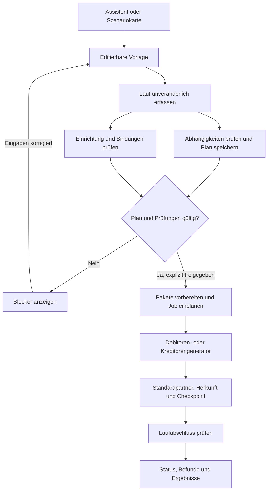
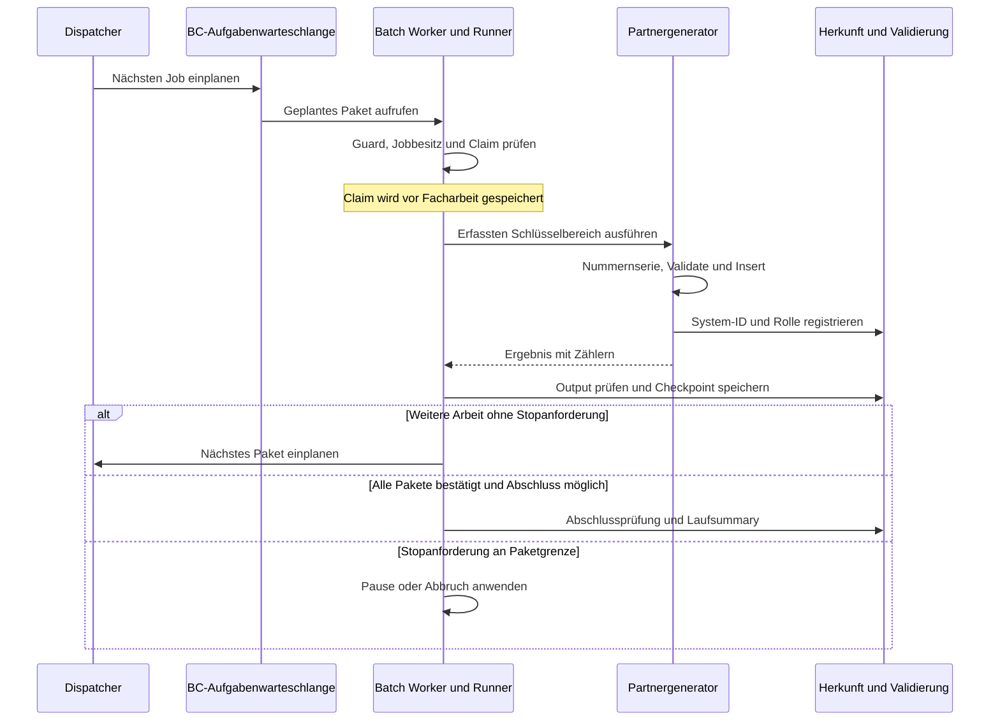
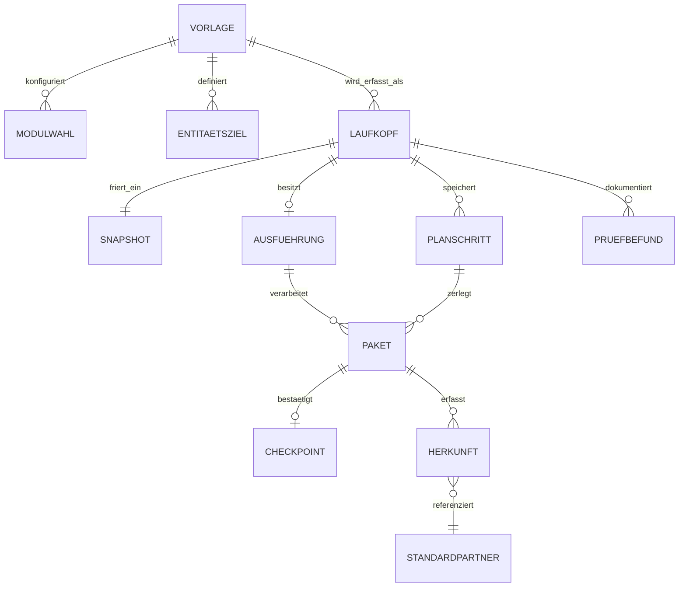
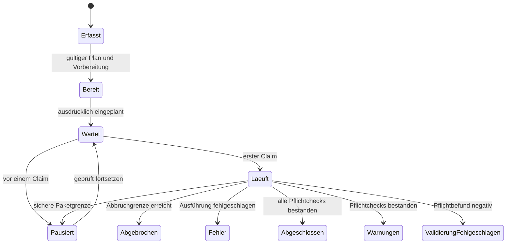
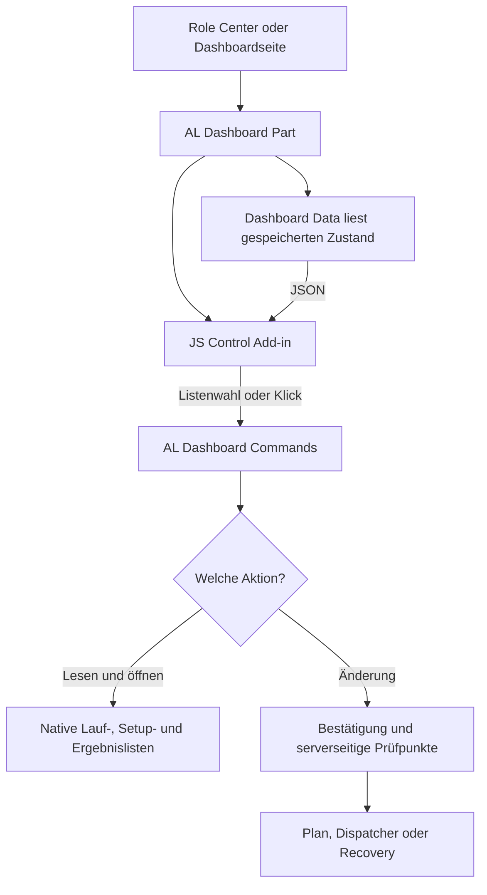

# Architekturdiagramme – Stand SF-018

Die Diagramme zeigen den vorhandenen Quellstand, nicht den kompletten geplanten Produktumfang. Dargestellt sind fachliche Daten- und Steuerflüsse, keine vollständige Auflistung der AL-Imports. Die Mermaid-Blöcke bleiben als Markdown editierbar.

## 1 · Vom Szenario zum Ergebnis

Vorschau und Plan starten nichts. Nur reine positive Debitoren-/Kreditorenziele können den aktuell ausgeführten Fachpfad nutzen. Die Generatorbindung wird gegen den gespeicherten Plan erneut geprüft. Bei Änderung erfasster Eingaben neu erfassen.

Quellen: [Snapshot Writer](../../src/ScenarioManagement/Codeunits/BCSFSnapshotWriter.Codeunit.al), [Plan Writer](../../src/DependencyManager/Codeunits/BCSFPlanWriter.Codeunit.al), [Setup Manager](../../src/SetupManager/Codeunits/BCSFSetupManager.Codeunit.al).

## 2 · Queue und Transaktionsgrenzen

Der Claim hat eine eigene Persistenzgrenze. Danach sollen Standarddaten, Herkunft, Checkpoint, bestätigter Paketstatus und der Folgeschritt gemeinsam persistieren. Ein fehlgeschlagener übernommener Batch kann zur Prüfung markiert werden. Kein blindes Replay. Standardtrigger/Fremderweiterungen und realer Queue-Betrieb sind gesondert in der Sandbox zu testen. `BCSF.SER` ist die Queue-Kategorie.

Quellen: [Worker](../../src/BackgroundProcessing/Codeunits/BCSFBatchWorker.Codeunit.al), [Runner](../../src/BackgroundProcessing/Codeunits/BCSFBatchRunner.Codeunit.al), [Dispatcher](../../src/BackgroundProcessing/Codeunits/BCSFQueueDispatcher.Codeunit.al), [Recovery](../RECOVERY.md).

## 3 · Persistente Daten

Logische Beziehungen, keine SQL-Fremdschlüsselbehauptung. Der erfasste Kopf behält seinen Anfangszustand. Der operative Status kommt aus `BCSF Run Execution`, die Abschlussqualität aus dem Befund. Herkunft referenziert Standardpartner über System-ID. Finanzpaket und App-Setup sind mandantenbezogen. Paketidentität und Partnerregeln stehen als Werte im Snapshot.

Quellen: [ScenarioManagement-Tabellen](../../src/ScenarioManagement/Tables), [Ausführungstabellen](../../src/BackgroundProcessing/Tables), [Herkunft](../../src/DataGeneration/Tables/BCSFGeneratedRecord.Table.al), [Befund](../../src/Validation/Tables/BCSFValidationResult.Table.al).

## 4 · Laufstatus aus Anwendersicht

Vereinfachte Ansicht, keine vollständige Transitionstabelle. **Erfasst** heißt ohne vorbereitete Ausführung, **Wartet** fasst eingeplant und wartend zusammen. Fehler und fehlgeschlagene Validierung haben unterschiedliche Ursachen, nicht automatisch wiederholen. Abbruch beendet ein laufendes Paket nicht sofort und löscht keine Ergebnisse.

Quellen: [Status-Enum](../../src/Core/Enums/BCSFRunStatus.Enum.al), [Ausführungsregeln](../../src/BackgroundProcessing/Codeunits/BCSFExecutionRules.Codeunit.al), [Laufabschluss](../../src/BackgroundProcessing/Codeunits/BCSFRunQuality.Codeunit.al).

## 5 · Dashboard und native Navigation

JS zeigt Daten und meldet Aktionscodes. AL entscheidet über zulässige Ausführung. Die native Laufkarte ist als Diagnoseweg geeignet, wenn im JS ein Drilldown fehlt.

Quellen: [Dashboard Part](../../src/Monitoring/Pages/BCSFDashboardPart.Page.al), [Commands](../../src/Monitoring/Codeunits/BCSFDashboardCommands.Codeunit.al), [Datenprojektion](../../src/Monitoring/Codeunits/BCSFDashboardData.Codeunit.al).

## Pflege beim nächsten Ticket

Nur betroffene Diagramme ändern. Neue Konfiguration, persistierte Ausführung und ausgeliefertes UI getrennt kennzeichnen. Bei einem neuen Generator den tatsächlich eingeführten fachlichen Pfad ergänzen. Modulzuordnung und AL-IDs stehen im [Inventar](MODULINVENTAR.md).
