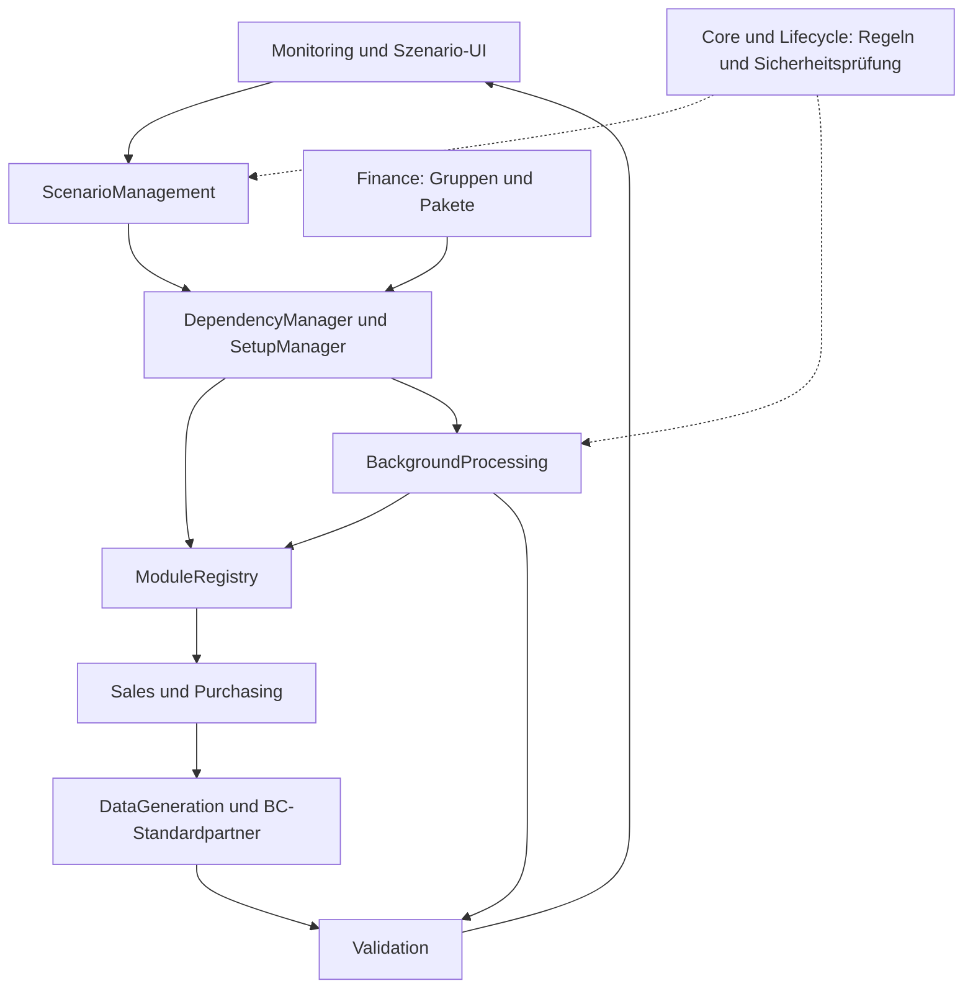

# Modul- und Objektinventar

Stand 18.11.2026. Verzeichnisstruktur aus dem gelieferten Quellarchiv: **24 Modulordner**, **14 mit AL-Code**, **121 AL-Dateien**, **118 numerische IDs**. Dateien unter `src/<Modul>/<Objekttyp>/`. Nicht-AL-Ressourcen werden getrennt genannt.

| Bereich | AL-Dateien | Aktuelle Aufgabe |
| --- | ---: | --- |
| `Assembly` | 0 | Montageprozesse geplant. |
| `BackgroundProcessing` | 17 | Ausführung, Pakete, Standard-Job-Queue-Anbindung, Claim, Checkpoint und Recovery. Orchestriert Abschlussprüfungen. |
| `CRM` | 0 | Eigener CRM-Generator geplant. Das BC-Standard-Marketing-Setup kann bei Partneranlage Kontakte erzeugen. |
| `Core` | 14 | App-Einrichtung, gemeinsame Enums/JSON-Vertrag, Sprache, Status und Permission Set. |
| `DataGeneration` | 7 | Seed/Werte, Partnerregeln, Herkunftsregistry und Herkunftsanzeige. |
| `DependencyManager` | 9 | Graph, Blocker, topologische Planung, stabile Generatorbindung und unveränderliche Planschritte. |
| `Finance` | 7 | Lesender Finanzcheck, SKR-Vorschau/Anwendung, Paketvermerk und Berichtseinrichtung. |
| `FixedAssets` | 0 | Anlagen-/Abschreibungsfälle geplant. |
| `IndustryProfiles` | 1 | Synthetischer Regel-/Wertekatalog. Kein auswählbares, vollständiges Branchenpreset. |
| `Inventory` | 0 | Artikel-, Varianten- und Lagergenerator geplant. Die Finanzpakete können Lagerbuchungseinrichtung anlegen. |
| `Lifecycle` | 4 | Sandbox-/Umgebungs-/Mandantenprüfung sowie Integrität von Konfiguration, Planung und Herkunft. |
| `Manufacturing` | 0 | Fertigungsprozesse geplant. |
| `ModuleRegistry` | 10 | Katalog, interne Generator-Schnittstelle und Probes. Echte Implementierungen kommen aus den Fachmodulen. |
| `Monitoring` | 18 | JS-Dashboard, BC-Rolle, native Ansicht, Paketzähler, Verlauf und Bedienoberflächen. |
| `Planning` | 0 | Eigener Planungs-/MRP-Generator geplant. Der aktuelle Laufplaner liegt in DependencyManager. |
| `ProcessEngine` | 0 | Eigene Fachprozesskoordination geplant. Die aktuell ausgeführte Partnerverarbeitung liegt in BackgroundProcessing. |
| `Projects` | 0 | Projektprozesse geplant. |
| `Purchasing` | 2 | Echter Kreditorengenerator und Enum-Bindung. Keine Einkaufsbelege. |
| `Sales` | 2 | Echter Debitorengenerator und Enum-Bindung. Keine Verkaufsbelege. |
| `ScenarioManagement` | 22 | Vorlagen, Wizard, Mengen, Partnerkonfiguration, Laufkopf und Snapshot. |
| `ServiceManagement` | 0 | Serviceprozesse geplant. |
| `SetupManager` | 4 | Lesende Einrichtungsvorprüfung und Maßnahmenliste. |
| `Validation` | 4 | Persistente Pflicht-/Warnbefunde, Schutz, Anzeige. Der Orchestrator liegt in BackgroundProcessing. |
| `Warehouse` | 0 | Warehouse-Fachgenerator geplant. Einzelne Setupprüfungen sind bereits im SetupManager. |

## Die Schichten im Zusammenhang

Pfeile zeigen die fachliche Zusammenarbeit, keine direkten AL-Imports. Registry löst Implementierungen über die EnumExtensions auf. Hintergrundverarbeitung prüft den Batchbesitz für die gemeinsame Partnerlogik per Pflicht-Subscriber.

## AL-Objekte nach Modul

Für Agents: bei einem neuen Ticket aus tatsächlichen Deklarationen und Dateipfaden aktualisieren. Geplante Objekte gehören in den Objektplan, nicht in die Liste vorhandener Objekte.

### BackgroundProcessing

| ID | Typ | Name und Quelle |
| --- | --- | --- |
| 90300 | table | [BCSF Batch](../../src/BackgroundProcessing/Tables/BCSFBatch.Table.al) |
| 90301 | enum | [BCSF Batch Status](../../src/BackgroundProcessing/Enums/BCSFBatchStatus.Enum.al) |
| 90302 | codeunit | [BCSF Queue Dispatcher](../../src/BackgroundProcessing/Codeunits/BCSFQueueDispatcher.Codeunit.al) |
| 90303 | codeunit | [BCSF Batch Worker](../../src/BackgroundProcessing/Codeunits/BCSFBatchWorker.Codeunit.al) |
| 90304 | codeunit | [BCSF Batch Recovery](../../src/BackgroundProcessing/Codeunits/BCSFBatchRecovery.Codeunit.al) |
| 90305 | table | [BCSF Run Execution](../../src/BackgroundProcessing/Tables/BCSFRunExecution.Table.al) |
| 90306 | codeunit | [BCSF Execution Rules](../../src/BackgroundProcessing/Codeunits/BCSFExecutionRules.Codeunit.al) |
| 90307 | codeunit | [BCSF Batch Runner](../../src/BackgroundProcessing/Codeunits/BCSFBatchRunner.Codeunit.al) |
| 90308 | codeunit | [BCSF Queue Failure](../../src/BackgroundProcessing/Codeunits/BCSFQueueFailure.Codeunit.al) |
| 90309 | page | [BCSF Execution List](../../src/BackgroundProcessing/Pages/BCSFExecutionList.Page.al) |
| 90310 | page | [BCSF Schedule Request](../../src/BackgroundProcessing/Pages/BCSFScheduleRequest.Page.al) |
| 90311 | page | [BCSF Batch List](../../src/BackgroundProcessing/Pages/BCSFBatchList.Page.al) |
| 90312 | pageextension | [BCSF Run Queue](../../src/BackgroundProcessing/PageExtensions/BCSFRunQueue.PageExt.al) |
| 90313 | table | [BCSF Run Control](../../src/BackgroundProcessing/Tables/BCSFRunControl.Table.al) |
| 90314 | table | [BCSF Batch Checkpoint](../../src/BackgroundProcessing/Tables/BCSFBatchCheckpoint.Table.al) |
| 90315 | codeunit | [BCSF Recovery Rules](../../src/BackgroundProcessing/Codeunits/BCSFRecoveryRules.Codeunit.al) |
| 90317 | codeunit | [BCSF Run Quality](../../src/BackgroundProcessing/Codeunits/BCSFRunQuality.Codeunit.al) |

### Core

| ID | Typ | Name und Quelle |
| --- | --- | --- |
| 90100 | table | [BCSF Factory Setup](../../src/Core/Tables/BCSFFactorySetup.Table.al) |
| 90101 | page | [BCSF Factory Setup Card](../../src/Core/Pages/BCSFFactorySetupCard.Page.al) |
| 90102 | enum | [BCSF Run Status](../../src/Core/Enums/BCSFRunStatus.Enum.al) |
| 90103 | enum | [BCSF Process Mode](../../src/Core/Enums/BCSFProcessMode.Enum.al) |
| 90104 | enum | [BCSF Usage Mode](../../src/Core/Enums/BCSFUsageMode.Enum.al) |
| 90105 | permissionset | [BCSF ADMIN](../../src/Core/PermissionSets/BCSFADMIN.PermissionSet.al) |
| 90106 | codeunit | [BCSF Setup Management](../../src/Core/Codeunits/BCSFSetupManagement.Codeunit.al) |
| 90107 | codeunit | [BCSF Run State Mgt](../../src/Core/Codeunits/BCSFRunStateMgt.Codeunit.al) |
| 90108 | enum | [BCSF Data Language](../../src/Core/Enums/BCSFDataLanguage.Enum.al) |
| 90109 | codeunit | [BCSF Language Mgt](../../src/Core/Codeunits/BCSFLanguageMgt.Codeunit.al) |
| 90110 | enum | [BCSF Plan Issue](../../src/Core/Enums/BCSFPlanIssue.Enum.al) |
| 90111 | codeunit | [BCSF Contract JSON](../../src/Core/Codeunits/BCSFContractJSON.Codeunit.al) |
| 90112 | enum | [BCSF Dependency Kind](../../src/Core/Enums/BCSFDependencyKind.Enum.al) |
| 90113 | enum | [BCSF Finance Mode](../../src/Core/Enums/BCSFFinanceMode.Enum.al) |

### DataGeneration

| ID | Typ | Name und Quelle |
| --- | --- | --- |
| 90250 | codeunit | [BCSF Seed Engine](../../src/DataGeneration/Codeunits/BCSFSeedEngine.Codeunit.al) |
| 90251 | table | [BCSF Generated Record](../../src/DataGeneration/Tables/BCSFGeneratedRecord.Table.al) |
| 90252 | codeunit | [BCSF Record Registry](../../src/DataGeneration/Codeunits/BCSFRecordRegistry.Codeunit.al) |
| 90253 | pageextension | [BCSF Run Synthetic Preview](../../src/DataGeneration/PageExtensions/BCSFRunSyntheticPreview.PageExt.al) |
| 90254 | page | [BCSF Generated Records](../../src/DataGeneration/Pages/BCSFGeneratedRecords.Page.al) |
| 90255 | pageextension | [BCSF Run Provenance](../../src/DataGeneration/PageExtensions/BCSFRunProvenance.PageExt.al) |
| 90256 | codeunit | [BCSF Partner Rules](../../src/DataGeneration/Codeunits/BCSFPartnerRules.Codeunit.al) |

### DependencyManager

| ID | Typ | Name und Quelle |
| --- | --- | --- |
| 90200 | table | [BCSF Dependency](../../src/DependencyManager/Tables/BCSFDependency.Table.al) |
| 90201 | codeunit | [BCSF Dependency Planner](../../src/DependencyManager/Codeunits/BCSFDependencyPlanner.Codeunit.al) |
| 90202 | codeunit | [BCSF Graph Sorter](../../src/DependencyManager/Codeunits/BCSFGraphSorter.Codeunit.al) |
| 90203 | table | [BCSF Plan Node](../../src/DependencyManager/Tables/BCSFPlanNode.Table.al) |
| 90204 | codeunit | [BCSF Plan Writer](../../src/DependencyManager/Codeunits/BCSFPlanWriter.Codeunit.al) |
| 90205 | page | [BCSF Plan Preview](../../src/DependencyManager/Pages/BCSFPlanPreview.Page.al) |
| 90206 | page | [BCSF Saved Run Steps](../../src/DependencyManager/Pages/BCSFSavedRunSteps.Page.al) |
| 90207 | codeunit | [BCSF Graph Self Check](../../src/DependencyManager/Codeunits/BCSFGraphSelfCheck.Codeunit.al) |
| 90208 | pageextension | [BCSF Run Planning](../../src/DependencyManager/PageExtensions/BCSFRunPlanning.PageExt.al) |

### Finance

| ID | Typ | Name und Quelle |
| --- | --- | --- |
| 90400 | codeunit | [BCSF Finance Package Mgt](../../src/Finance/Codeunits/BCSFFinancePackageMgt.Codeunit.al) |
| 90402 | codeunit | [BCSF Finance Setup Check](../../src/Finance/Codeunits/BCSFFinanceSetupCheck.Codeunit.al) |
| 90403 | table | [BCSF Finance Package](../../src/Finance/Tables/BCSFFinancePackage.Table.al) |
| 90404 | page | [BCSF Finance Selection](../../src/Finance/Pages/BCSFFinanceSelection.Page.al) |
| 90405 | page | [BCSF Finance Preview](../../src/Finance/Pages/BCSFFinancePreview.Page.al) |
| 90406 | pageextension | [BCSF Finance Setup](../../src/Finance/PageExtensions/BCSFFinanceSetup.PageExt.al) |
| 90407 | pageextension | [BCSF Run Finance](../../src/Finance/PageExtensions/BCSFRunFinance.PageExt.al) |

### IndustryProfiles

| ID | Typ | Name und Quelle |
| --- | --- | --- |
| 90154 | codeunit | [BCSF Synthetic Rules](../../src/IndustryProfiles/Codeunits/BCSFSyntheticRules.Codeunit.al) |

### Lifecycle

| ID | Typ | Name und Quelle |
| --- | --- | --- |
| 90375 | codeunit | [BCSF Environment Guard](../../src/Lifecycle/Codeunits/BCSFEnvironmentGuard.Codeunit.al) |
| 90377 | codeunit | [BCSF Scenario Guard](../../src/Lifecycle/Codeunits/BCSFScenarioGuard.Codeunit.al) |
| 90378 | codeunit | [BCSF Planning Guard](../../src/Lifecycle/Codeunits/BCSFPlanningGuard.Codeunit.al) |
| 90379 | codeunit | [BCSF Provenance Guard](../../src/Lifecycle/Codeunits/BCSFProvenanceGuard.Codeunit.al) |

### ModuleRegistry

| ID | Typ | Name und Quelle |
| --- | --- | --- |
| – | interface | [BCSF Generator](../../src/ModuleRegistry/Interfaces/BCSFGenerator.Interface.al) |
| 90175 | table | [BCSF Generator Registry](../../src/ModuleRegistry/Tables/BCSFGeneratorRegistry.Table.al) |
| 90176 | enum | [BCSF Generator Type](../../src/ModuleRegistry/Enums/BCSFGeneratorType.Enum.al) |
| 90177 | codeunit | [BCSF Generator Registry Mgt](../../src/ModuleRegistry/Codeunits/BCSFGeneratorRegistryMgt.Codeunit.al) |
| 90178 | codeunit | [BCSF Customer Probe](../../src/ModuleRegistry/Codeunits/BCSFCustomerProbe.Codeunit.al) |
| 90179 | codeunit | [BCSF Vendor Probe](../../src/ModuleRegistry/Codeunits/BCSFVendorProbe.Codeunit.al) |
| 90180 | codeunit | [BCSF Missing Generator](../../src/ModuleRegistry/Codeunits/BCSFMissingGenerator.Codeunit.al) |
| 90181 | codeunit | [BCSF Contract Self Check](../../src/ModuleRegistry/Codeunits/BCSFContractSelfCheck.Codeunit.al) |
| 90182 | page | [BCSF Generator Catalog](../../src/ModuleRegistry/Pages/BCSFGeneratorCatalog.Page.al) |
| 90183 | codeunit | [BCSF Probe Support](../../src/ModuleRegistry/Codeunits/BCSFProbeSupport.Codeunit.al) |

### Monitoring

| ID | Typ | Name und Quelle |
| --- | --- | --- |
| – | controladdin | [BCSF Dashboard](../../src/Monitoring/ControlAddIns/BCSFDashboard.ControlAddIn.al) |
| – | profile | [BCSF Scenario Factory](../../src/Monitoring/Profiles/BCSFScenarioFactory.Profile.al) |
| 90350 | table | [BCSF Run Event](../../src/Monitoring/Tables/BCSFRunEvent.Table.al) |
| 90351 | page | [BCSF Factory Dashboard](../../src/Monitoring/Pages/BCSFFactoryDashboard.Page.al) |
| 90352 | page | [BCSF Step Progress](../../src/Monitoring/Pages/BCSFStepProgress.Page.al) |
| 90353 | page | [BCSF Run Events](../../src/Monitoring/Pages/BCSFRunEvents.Page.al) |
| 90354 | table | [BCSF Step Metric](../../src/Monitoring/Tables/BCSFStepMetric.Table.al) |
| 90355 | page | [BCSF Run Overview](../../src/Monitoring/Pages/BCSFRunOverview.Page.al) |
| 90356 | codeunit | [BCSF Monitoring Mgt](../../src/Monitoring/Codeunits/BCSFMonitoringMgt.Codeunit.al) |
| 90357 | codeunit | [BCSF Run Event Writer](../../src/Monitoring/Codeunits/BCSFRunEventWriter.Codeunit.al) |
| 90358 | pageextension | [BCSF Run Monitoring](../../src/Monitoring/PageExtensions/BCSFRunMonitoring.PageExt.al) |
| 90359 | pageextension | [BCSF Wizard Execution](../../src/Monitoring/PageExtensions/BCSFWizardExecution.PageExt.al) |
| 90360 | pageextension | [BCSF Batch Diagnostics](../../src/Monitoring/PageExtensions/BCSFBatchDiagnostics.PageExt.al) |
| 90362 | page | [BCSF Dashboard Part](../../src/Monitoring/Pages/BCSFDashboardPart.Page.al) |
| 90363 | page | [BCSF Dashboard Host](../../src/Monitoring/Pages/BCSFDashboardHost.Page.al) |
| 90364 | page | [BCSF Factory Role Center](../../src/Monitoring/Pages/BCSFFactoryRoleCenter.Page.al) |
| 90365 | codeunit | [BCSF Dashboard Data](../../src/Monitoring/Codeunits/BCSFDashboardData.Codeunit.al) |
| 90366 | codeunit | [BCSF Dashboard Commands](../../src/Monitoring/Codeunits/BCSFDashboardCommands.Codeunit.al) |

### Purchasing

| ID | Typ | Name und Quelle |
| --- | --- | --- |
| 90450 | codeunit | [BCSF Vendor Generator](../../src/Purchasing/Codeunits/BCSFVendorGenerator.Codeunit.al) |
| 90452 | enumextension | [BCSF Vendor Binding](../../src/Purchasing/EnumExtensions/BCSFVendorBinding.EnumExt.al) |

### Sales

| ID | Typ | Name und Quelle |
| --- | --- | --- |
| 90425 | codeunit | [BCSF Customer Generator](../../src/Sales/Codeunits/BCSFCustomerGenerator.Codeunit.al) |
| 90427 | enumextension | [BCSF Customer Binding](../../src/Sales/EnumExtensions/BCSFCustomerBinding.EnumExt.al) |

### ScenarioManagement

| ID | Typ | Name und Quelle |
| --- | --- | --- |
| 90125 | table | [BCSF Scenario](../../src/ScenarioManagement/Tables/BCSFScenario.Table.al) |
| 90126 | table | [BCSF Scenario Module](../../src/ScenarioManagement/Tables/BCSFScenarioModule.Table.al) |
| 90127 | table | [BCSF Data Target](../../src/ScenarioManagement/Tables/BCSFDataTarget.Table.al) |
| 90128 | table | [BCSF Run Header](../../src/ScenarioManagement/Tables/BCSFRunHeader.Table.al) |
| 90129 | table | [BCSF Run Step](../../src/ScenarioManagement/Tables/BCSFRunStep.Table.al) |
| 90130 | codeunit | [BCSF Scenario Manager](../../src/ScenarioManagement/Codeunits/BCSFScenarioManager.Codeunit.al) |
| 90131 | page | [BCSF Scenario Card](../../src/ScenarioManagement/Pages/BCSFScenarioCard.Page.al) |
| 90132 | page | [BCSF Scenario Wizard](../../src/ScenarioManagement/Pages/BCSFScenarioWizard.Page.al) |
| 90133 | page | [BCSF Scenario List](../../src/ScenarioManagement/Pages/BCSFScenarioList.Page.al) |
| 90134 | table | [BCSF Run Snapshot](../../src/ScenarioManagement/Tables/BCSFRunSnapshot.Table.al) |
| 90135 | enum | [BCSF Entity Type](../../src/ScenarioManagement/Enums/BCSFEntityType.Enum.al) |
| 90136 | page | [BCSF Scenario Modules](../../src/ScenarioManagement/Pages/BCSFScenarioModules.Page.al) |
| 90137 | page | [BCSF Data Targets](../../src/ScenarioManagement/Pages/BCSFDataTargets.Page.al) |
| 90138 | page | [BCSF Run List](../../src/ScenarioManagement/Pages/BCSFRunList.Page.al) |
| 90139 | page | [BCSF Run Card](../../src/ScenarioManagement/Pages/BCSFRunCard.Page.al) |
| 90140 | page | [BCSF Frozen Targets](../../src/ScenarioManagement/Pages/BCSFFrozenTargets.Page.al) |
| 90141 | page | [BCSF Frozen Modules](../../src/ScenarioManagement/Pages/BCSFFrozenModules.Page.al) |
| 90142 | enum | [BCSF Quantity Preset](../../src/ScenarioManagement/Enums/BCSFQuantityPreset.Enum.al) |
| 90143 | codeunit | [BCSF Scenario Policy](../../src/ScenarioManagement/Codeunits/BCSFScenarioPolicy.Codeunit.al) |
| 90144 | codeunit | [BCSF Snapshot Writer](../../src/ScenarioManagement/Codeunits/BCSFSnapshotWriter.Codeunit.al) |
| 90145 | codeunit | [BCSF Scenario DB Events](../../src/ScenarioManagement/Codeunits/BCSFScenarioDBEvents.Codeunit.al) |
| 90146 | enum | [BCSF Module Type](../../src/ScenarioManagement/Enums/BCSFModuleType.Enum.al) |

### SetupManager

| ID | Typ | Name und Quelle |
| --- | --- | --- |
| 90225 | table | [BCSF Setup Diff](../../src/SetupManager/Tables/BCSFSetupDiff.Table.al) |
| 90226 | codeunit | [BCSF Setup Manager](../../src/SetupManager/Codeunits/BCSFSetupManager.Codeunit.al) |
| 90227 | page | [BCSF Setup Diff Preview](../../src/SetupManager/Pages/BCSFSetupDiffPreview.Page.al) |
| 90228 | pageextension | [BCSF Run Preflight](../../src/SetupManager/PageExtensions/BCSFRunPreflight.PageExt.al) |

### Validation

| ID | Typ | Name und Quelle |
| --- | --- | --- |
| 90325 | table | [BCSF Validation Result](../../src/Validation/Tables/BCSFValidationResult.Table.al) |
| 90326 | codeunit | [BCSF Validation Manager](../../src/Validation/Codeunits/BCSFValidationManager.Codeunit.al) |
| 90327 | enum | [BCSF Validation Severity](../../src/Validation/Enums/BCSFValidationSeverity.Enum.al) |
| 90328 | page | [BCSF Validation Results](../../src/Validation/Pages/BCSFValidationResults.Page.al) |

## Weitere Laufzeit-Ressourcen

Unter [Monitoring/Dashboard](../../src/Monitoring/Dashboard) liegen `dashboard.js`, `dashboard.css`, `startup.js` und `translations.js`. Unter [Translations](../../Translations) liegen generierte und gepflegte XLIFF-Ressourcen. Der AL-Quellstand hat keine externe App-Abhängigkeit im Manifest. XERJ ist nur Entwicklungswerkzeug.

[Architekturdiagramme](ARCHITEKTUR-DIAGRAMME.md) · [Funktionsstand](FUNKTIONSSTAND.md) · [Projektkonventionen](../CONVENTIONS.md)
